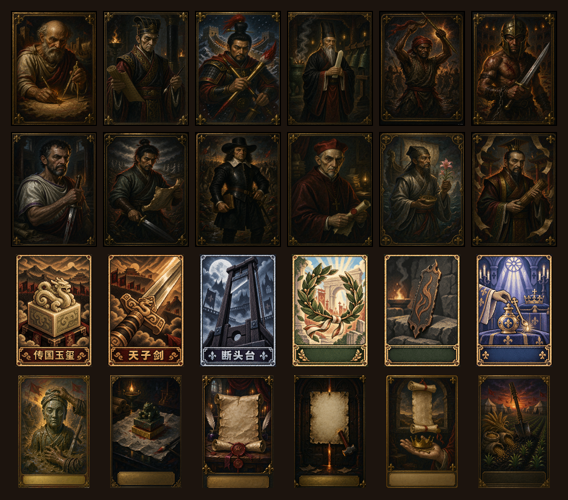

# World History (世界历史)

[中文](README.md) | **English**

A history-themed Balatro content mod: emperors, relics, institutions and revolutions — world history pressed into jokers.

**v0.3.0**: 49 jokers + 26 consumables + 18 vouchers + 6 Boss blinds + 2 tags + 20 opening omens, fully localized in Chinese and English. **Art is 94 / 101** — every joker, consumable, voucher, sticker and tag now uses a custom atlas; only the 6 Boss blinds are still placeholder frames.

Three interlocking systems — **coronation**, **annexation** and **revolution** — carry five figures from Ying Zheng to Louis XVI.

## Installation

1. Install [Steamodded (SMODS)](https://github.com/Steamodded/smods) and [Lovely](https://github.com/ethangreen-dev/lovely-injector). Requires Lovely + SMODS 1.0+; Talisman is not needed.
2. Download the latest `worldhist-vX.Y.Z.zip` from [Releases](https://github.com/jasperwang614/worldhist/releases) and unzip it to get the `worldhist` folder.
3. Drop that folder into `%APPDATA%/Balatro/Mods/` (cloning the repo there works too).
4. Launch the game — **World History** should appear in the MODS menu.

## The Three Systems

### 1. Coronation: form pairs

Five historical figures exist in two versions — a **base form** and an **emperor form** (11 cards in total). Coronation is not an upgrade; it is **a change of identity**. Everything the base form did is void, and the emperor form calculates from scratch.

| Base form | Emperor form | The history it encodes |
|---|---|---|
| Ying Zheng | Qin Shi Huang | Unification of the six states → the annexation engine itself |
| Louis Auguste (amateur locksmith) | Louis XVI | Royal annuity → Bourbon wealth plus deficit inflation |
| Hongli (practices his seal) | Qianlong | Practises stamping on single cards; once crowned, his seal moves the whole deck |
| Bonaparte | Napoleon I | **Clickable on himself — he crowns himself** |
| Julius | Caesar | Grants a "Senator" sticker to both neighbours on coronation |

There are five coronation sources: **Imperial Seal**, **Laurel Wreath**, **Royal Crown**, **Monomakh's Cap** and **Anointing**. China's seal, Rome's laurel and Europe's crown all share the same effect — a mandate of heaven, a proof of legitimacy — and differ only in flavour.

### 2. Annexation: Qin Shi Huang's effect tree

When Qin Shi Huang is crowned, he swallows every other joker on the board and turns them into **shells**. For the rest of the hand, each shell's effect is relayed in order — the outer shell remains, but the contents belong to him. Each annexed joker grants **+25 chips** (standardising weights and measures).

The cost is real: shells no longer score independently, annexed cards cannot be sold, and their slots are managed by the annexation system. The more you swallow, the thicker your board becomes — and the harder it is to take apart. That is the weight of unification.

### 3. Revolution: the guillotine and the revolutionaries

- **Guillotine**: pick an emperor → revert them to their base form and return one random coronation relic. The shells are released first, then the emperor falls.
- **Head of Louis XVI**: the sole exception. For him the guillotine is not a reversal but a revolution — no reverting, only the head. A blank card that can be sold *only* during Robespierre's Boss blind, and selling it **ends that blind immediately**.
- **Brutus**: *Et tu, Brute* — on the 15th scoring card of each run, he assassinates Caesar and permanently gains **X6**.
- **Revolutionaries** (Chen Sheng, Spartacus): X3 on a High Card / X3 on the lowest-scoring card. The voucher **One-Eyed Stone Man** makes a High Card retrigger every revolutionary joker — Chen Sheng plus the Stone Man means a double trigger at **X9**.
- **Omen of Revolution** (tag): the next Boss is guaranteed to be a revolutionary. It turns "skip the revolutionary Boss" into a controlled gamble.

## Other Content Lines

**Relics (14 tarot-slot consumables)**: He's Jade Disc, Tiger Tally, Jiaozi banknote, Sword of the Son of Heaven, Iron Certificate of Immunity, Edict of Self-Reproach, Dagger, Holy Fire Token, and more. Most read "choose a card or a joker and change its fate".

- **Holy Fire Token**: marks the current Boss; meeting that same Boss again disables its effect outright.
- **Iron Certificate of Immunity**: choose a joker — the first time it would be destroyed this run, it survives (the iron-writ pledge; the man who issued it is long dead, but it still works once).
- **Edict of Self-Reproach**: reroll this run's next Boss blind — the emperor blames himself, and heaven picks a different punishment.

**Spectral (3)**: Amber Room, Rubicon, Treasure Fleet.

**Policies (18 vouchers)**: an entire institutional history. Commanderies and Counties, Imperial Examination, Feudalism, Magna Carta, Solon's Reforms, Napoleonic Code, Ninety-Five Theses, East India Company, Enclosure, Glorious Revolution, Hanseatic League, Grain Ever-Normal Granary, Tuntian Farming, Mongol Yam, Library of Alexandria, Lydian Coinage, Ceded Territory, One-Eyed Stone Man.

The policy line leans heavily on **negative clauses**: Ceded Territory (joker slots −1 for +$5 per round), Solon's Reforms (hand size +2, −$2 at round start), Feudalism (+1 joker slot, but joker sell value halved). Institutions are never free.

**Star Charts (9 planet cards)**: hand level equals the level of human understanding — each astronomical discovery levels up the matching hand. Ziwei Enclosure → High Card (the lone pole star), Double Star → Pair, Four Symbols → Four of a Kind, Five-Planet Conjunction → Straight, Milky Way → Flush, The Ecliptic → Straight Flush, Binary Stars → Two Pair, Triple Star → Three of a Kind, Three Enclosures → Full House. Mechanics are identical to vanilla planet cards, with zero extra numbers.

**Boss blinds (6)**: The Terror: Robespierre; *L'État, C'est Moi*: Louis XIV (shop prices doubled); The Grand Canal: Emperor Yang of Sui (your first hand each round must contain at least 4 cards); Gagging the Critics: King Li of Zhou; The Black Death; Quipu: The Inca.

## The Omen System

Every run opens with **3 omens drawn from a pool of 20**; you pick one and it applies for the whole run. The design rule: each omen is **one clear build direction plus one cost**. Nothing is purely punitive, and nothing is purely free — otherwise there would be no decision.

| Omen | Gain | Cost |
|---|---|---|
| Dynastic Change | +1 joker slot | The omen randomly changes every 2 antes thereafter |
| Mercantilism | +$20 at the start | Shop prices +25% |
| Militarism | X-mult effects +25% | −1 discard per round |
| Bureaucracy | +1 joker slot | −1 hand size |
| Hundred Schools of Thought | +1 consumable slot | −1 joker slot |
| Chaos | +$12 per Boss defeated | Boss score requirement +35% |
| Pax | Boss score requirement −20% | — |
| Leave It to Fate | A random pick from the other omens | Whatever you draw is what you get |

The rest of the pool: **Court of Hearts** (only Hearts score), **Iron Age** (only Spades score), **Great Purge**, **Scorched Earth**, **Age of Flushes**, **Amnesty**, **Recommendation System**, **Aristocratic Clans**, **Arsenal**, **Golden Calf**, **Schism**, **Conscription**.

Suit locks hook into the return value of `get_poker_hand_info` — preview and settlement share that one entry point, so **the score you see on screen is the score you get**.

## Status and Known Issues

- **All 101 items are implemented and pass static checks**: syntax 12/12 files, 102 localization keys per language with zero missing and zero orphans, 26/26 hooked vanilla functions present.
- **Test coverage is low**: only the omen system has been verified end-to-end (opening pick → Dynastic Change → rotation to Iron Age at ante 3). The remaining entries still need full-run testing.
- **Art is 94 / 101**: six atlases are wired up; only the 6 Boss blinds still fall back to vanilla frames.
  - `hist_jokers` 10×5 (49 cards: five form pairs + 36 historical figures + the Head of Louis XVI)
  - `hist_relics` 10×3 (14 relics + 3 spectral + 9 planet cards)
  - `hist_vouchers` 10×2 (18 policies)
  - `hist_stickers` 10×2 (stickers, one Chinese row and one English row) and `hist_tags` (2 tags)
  - Both 1x and 2x sets ship; frames are 71×95 / 142×190.
- Some numbers are first drafts; balance will be adjusted after full-run integration testing.

## Art Wanted 🎨

All six content lines are drawn; **only the 6 Boss blinds remain** — Reign of Terror (Robespierre), L'État c'est moi (Louis XIV), the Grand Canal (Sui Yangdi), Suppressing Criticism (King Li of Zhou), the Black Death, and Quipu (the Inca). They currently borrow vanilla Boss frames.

Replacing any existing card is welcome too — same spec, drops straight in:

- Style: Balatro card art — heavy black outlines, flat fills, high-saturation clashing colours, **no text on the art** (all copy lives in localization).
- Size: 71×95 per frame (1x) / 142×190 (2x); transparent margins differ by type — jokers full-bleed, vouchers and consumables 4–6px on each side.
- Submit frames by pos index as a PR, or open an Issue with your layered source file. Accepted art gets enabled as a custom atlas.

## License

Mod content and code © jasperwang614. Balatro © LocalThunk. This is fan-made content, unaffiliated with the official game.
