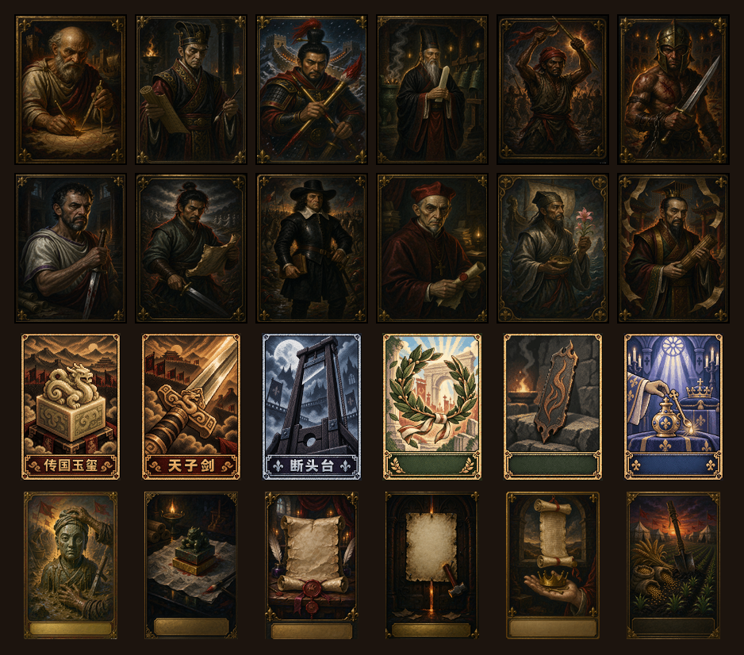

# 世界历史 WORLD HISTORY

**中文** | [English](README.en.md)

历史主题 Balatro 内容 Mod：皇帝、器物、制度与革命——把世界史做进小丑牌。

**v0.4.1**：51 张小丑 + 26 张消耗牌 + 18 张优惠券 + 6 个 Boss 盲注 + 2 个标签 + 20 个开局时局，中英双语文案。**美术 96 / 103 已出图**——小丑、消耗牌、优惠券、贴纸、标签全部接入自定义图集，只剩 6 个 Boss 仍在征集。

三条主线——**登基、吞并、革命**——串起从嬴政到路易十六的五组人物。

## 安装

1. 安装 [Steamodded (SMODS)](https://github.com/Steamodded/smods) 与 [Lovely](https://github.com/ethangreen-dev/lovely-injector)（依赖 Lovely + SMODS 1.0+，无需 Talisman）。
2. 从 [Releases](https://github.com/jasperwang614/worldhist/releases) 下载最新的 `worldhist-vX.Y.Z.zip`，解压得到 `worldhist` 文件夹。
3. 把该文件夹放入 `%APPDATA%/Balatro/Mods/`（也可以直接把仓库克隆进去）。
4. 启动游戏，MODS 菜单应能看到 World History。

## 三条主线

### 一、登基：形态对

五组人物各有"登基前"与"皇帝形态"两个版本，共 11 张卡。登基不是升级，是**换一个身份**：初始形态的效果全部作废，皇帝形态重新算。

| 初始形态 | 皇帝形态 | 史实内核 |
|---|---|---|
| 嬴政 | 秦始皇 | 扫六合 → 吞并系统本体 |
| 路易·奥古斯特（修锁爱好者） | 路易十六 | 王室年金 → 波旁家底 + 赤字通胀 |
| 弘历（练盖章） | 乾隆 | 先在牌上练章，登基后盖得动整个牌堆 |
| 波拿巴 | 拿破仑一世 | **可点击自己直接加冕**——自己把冠戴上 |
| 尤利乌斯 | 凯撒 | 登基时授予左右邻座"元老"角标 |

登基来源有五个：**传国玉玺、桂冠、王冠、莫诺马赫冠、涂油礼**——中国的玉玺、罗马的桂冠、欧洲的王冠，同效果原则（都是"受命于天，正统凭证"），只是风味不同。

### 二、吞并：秦始皇的效果树

秦始皇登基时吞掉全场的其它小丑，把它们变成**壳**，此后本手牌按顺序代发每个壳的效果——外壳还在，里子全归你。每吞 1 个 +25 筹码（统一度量衡）。

代价是真实的：壳不再独立计分，被吞掉的卡不可出售，槽位由吞并系统统一调度。吞得越多，牌面越厚，但也越难拆解——这就是"统一"的重量。

### 三、革命：断头台与革命者

- **断头台**：选一个皇帝 → 还原成初始形态，并返还一张随机登基器物。树倒猢狲散，壳先放出来再还原。
- **路易十六的头**：唯一例外。断头台对他是革命，不还原，直接产出"头"——白板一张，只能在罗伯斯庇尔的 Boss 战中出售，出售即**直接终结该 Blind**。
- **布鲁图**：Et tu, Brute——每局第 15 张计分牌刺杀凯撒，自己永久 X6。
- **革命者**（陈胜、斯巴达克斯）：高牌 X3 / 点数最小牌 X3。优惠券**石人一只眼**会让高牌重新触发所有革命者小丑——陈胜 + 石人同场，高牌双触发 X9。
- **革命预兆**（标签）：下一个 Boss 必为革命者。让"跳过革命者 Boss"变成可控的小赌局。

## 其它内容线

**器物（14 张塔罗槽）**：和氏璧、虎符、交子、天子剑、免死金牌、罪己诏、匕首、圣火令……多数是"选一张牌/一个小丑，改变它的命运"。

- **圣火令**：标记当前 Boss，再遇到同一个 Boss 时直接禁用其效果。
- **免死金牌**：选一张小丑，本局它第一次将被销毁时免除（丹书铁券）。
- **罪己诏**：重掷本局下一个 Boss——皇帝下罪己诏，老天换一种惩罚。

**幻灵（3 张）**：琥珀屋、卢比孔河、郑和宝船。

**政策（18 张优惠券）**：整部制度史。郡县制、科举制、分封制、大宪章、梭伦改革、拿破仑法典、九十五条论纲、东印度公司、圈地运动、光荣革命、汉萨同盟、常平仓、屯田、蒙古驿站、亚历山大图书馆、吕底亚铸币、献土、石人一只眼。

政策线大量使用**负面条款**：献土（小丑上限 -1，换每回合 +$5）、梭伦改革（手牌上限 +2，回合开始 -$2）、分封制（上限 +1，但小丑售价减半）。制度从来不是白给的。

**星图（9 张星球牌）**：牌型等级 = 认知层级，天文大发现给对应牌型升一级。紫微垣 → 高牌（帝星孤悬）、双子星 → 对子、四象 → 四条、五星连珠 → 顺子、银河 → 同花、黄道 → 同花顺、联星 → 两对、三合星 → 三条、三垣 → 葫芦。机制与原版星球牌完全一致，零数值。

**Boss 盲注（6 个）**：恐怖统治·罗伯斯庇尔、朕即国家·路易十四（商店价格翻倍）、大运河·隋炀帝（每回合首手必须打满 4 张）、弭谤·周厉王、黑死病、结绳记事·印加。

## 时局系统

每局开局从 20 个时局里**抽 3 选 1**，本局生效。设计原则：每个时局 = 一条明确的构筑方向 + 一条代价，不做纯惩罚，也不做纯白给。

| 时局 | 得 | 失 |
|---|---|---|
| 改朝换代 | 小丑槽 +1 | 此后每 2 个底注时局随机更换 |
| 重商主义 | 开局 +$20 | 商店价格 +25% |
| 军国主义 | X 倍率效果 +25% | 每回合弃牌 -1 |
| 官僚制 | 小丑槽 +1 | 手牌上限 -1 |
| 百家争鸣 | 消耗牌槽 +1 | 小丑槽 -1 |
| 乱世 | 每个 Boss 掉落 +$12 | Boss 要求分数 +35% |
| 治世 | Boss 要求分数 -20% | — |
| 听天由命 | 从其余时局中随机一个 | 抽到什么就是什么 |

另有**血色宫廷**（只有红桃计分）、**黑铁时代**（只有黑桃计分）、**大清洗**、**焦土**、**同花时代**、**大赦天下**、**察举制**、**门阀**、**军械库**、**金牛犊**、**分裂**、**征兵制**。

花色锁定类的过滤挂在 `get_poker_hand_info` 的返回值上——预览和结算共用同一个入口，**UI 上看到多少分，结算就是多少分**。

## 当前状态与已知事项

- **103 件内容全部已实现，静态检查通过**（语法 12/12、本地化键零缺失、26 个挂点全部命中）。
- **实测覆盖率低**：仅时局系统跑通过完整链路（开局 3 选 1 → 改朝换代 → ante 3 轮换到黑铁时代）。其余条目待整局实测。
- **美术 96 / 103**：六张图集全部接入，仅 6 个 Boss 盲注仍是原版帧占位。
  - `hist_jokers` 10×6（51 张：5 组形态对 + 风云人物 38 张 + 路易十六的头）
  - `hist_relics` 10×3（器物 14 张 + 幻灵 3 张 + 星图 9 张）
  - `hist_vouchers` 10×2（政策 18 张）
  - `hist_stickers` 10×2（贴纸中英各一行）、`hist_tags`（2 个标签）
  - 图集按 1x / 2x 两套随游戏分辨率切换，帧尺寸 71×95 / 142×190。
- 部分数值为草案，整局平衡待后续版本。

## 这个 mod 是怎么做出来的（AI 说明）

先把话说清楚：**卡面美术是 AI 生成的，代码和文案也有 AI 参与。** 我不想让这件事靠别人猜出来，也不想等被指出来才承认。

具体分工是这样的：

- **卡面（103 件中的 96 件）**：用文生图模型出图。画什么、什么朝代气质、主体怎么摆、配色往哪走，是我写提示词定的；出图后由我筛选、裁切对齐图集格线、调色提亮、拼成 1x / 2x 两套。像素是模型产的，「这张卡该画成什么样」不是。
- **代码**：AI 辅助编写，设计和验收在我。登基、吞并、革命三套系统的规则，时局轮换的状态机，花色锁定的计分入口，都是我先定行为再和模型一起实现，然后对着 Balatro 反编译出来的源码逐条核对——比如 `blind.in_blind` 这个字段其实不存在，是查了源码才发现的。
- **文案与本地化**：中英双语 200 多条。主题、史实内核、卡名由我定，措辞在 AI 草稿上改。
- **数值与平衡**：103 个对象的数值、彼此克制的关系、每个时局「一得一失」的分寸，是几十局测试里一点点调出来的。

我知道不少玩家不接受 mod 里出现 AI 素材，这个态度是合理的，我没打算说服谁。把这个说明放在这里，只是让你在下载之前就知道自己装的是什么。

美术我按**可替换的占位**对待：图集格位、帧尺寸、留白规格都写在下面。任何一张都能用一张画好的 PNG 直接换掉，换掉的会署名。

## 美术征集 🎨

六条内容线已全部出图，**只剩 6 个 Boss 盲注**：恐怖统治·罗伯斯庇尔、朕即国家·路易十四、大运河·隋炀帝、弭谤·周厉王、黑死病、结绳记事·印加。这六个目前仍用原版 Boss 帧占位。

**现有 96 张 AI 卡面全部按占位处理，欢迎画师逐张替换**——这是这个 mod 现在最需要的帮助。同规格即可直接合入，作者会在 README 和 Release 里署名。

- 风格：Balatro 卡面，粗黑描边、平涂、高饱和撞色，**牌面无文字**（文案走本地化）。
- 尺寸：单帧 71×95（1x）/ 142×190（2x），透明留白按类型不同——小丑满幅、券与消耗牌左右各留 4–6px。
- 投稿：画好的帧按 pos 编号提交 PR 或 Issue 附图层文件；合入后统一启用自定义图集。

## 许可

Mod 内容与代码版权归作者 jasperwang614。原版游戏版权归 LocalThunk。本 Mod 为玩家内容，与官方无关。

---

EN: A history-themed Balatro content mod — emperors, relics, institutions and revolutions. v0.4.1: 51 jokers, 26 consumables, 18 vouchers, 6 Boss blinds, 2 tags and 20 opening "omens", art 96/103. Three intertwined systems: **coronation** (five figures each with a base and an emperor form), **annexation** (Qin Shi Huang swallows the board into shells that relay their effects), and **revolution** (guillotine, Brutus, and a head that ends a Boss blind when sold). Full Chinese and English localization. Requires Lovely + Steamodded 1.0+.
